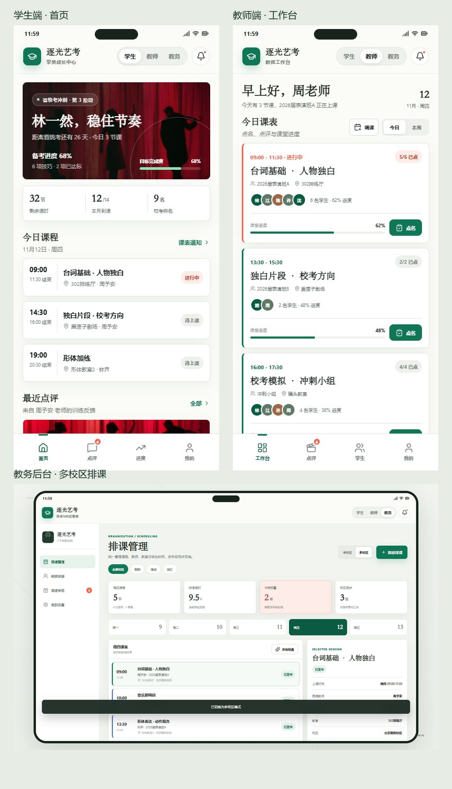

# 逐光艺考双端体验原型

面向艺考培训机构的产品原型，包含学生端、教师端与教务后台。

## 在线演示

https://maidongchan.github.io/yikao-training-prototype/



## 体验内容

- 学生端：课表、考勤与课消、视频点评、模拟考趋势、备考进度、师资、考学节点、请假。
- 教师端：今日与本周课表、课堂点名、视频与文字点评、进度录入、成绩录入与排名、请假审批、学生档案。
- 教务后台：周排课、教师与教室资源、跨校区冲突检查、教师可排时间、调课审批、组织与权限设置。
- 多端联动：点名扣课时、点评同步、学生请假回流审批、教师调课回流教务确认。
- 双运营模式：单校区模式隐藏复杂组织层级；多校区模式启用校区范围、跨校区教师冲突和汇总管理。

## 本地运行

无需安装依赖，直接打开 `index.html`。

如需通过 HTTP 预览：

```powershell
python -m http.server 4173 --bind 127.0.0.1
```

访问 `http://127.0.0.1:4173/`。

## 发布到 GitHub Pages

仓库使用 GitHub Pages 的“从分支部署”模式。

首次配置：

```powershell
gh api --method POST repos/{owner}/{repo}/pages -f source[branch]=main -f source[path]=/
```

完成配置后，每次推送 `main` 分支都会自动更新线上页面。

页面地址通常为：

```text
https://{owner}.github.io/{repo}/
```

## 说明

当前页面中的品牌、学员、教师、课程和成绩均为演示数据，不含真实个人信息。
